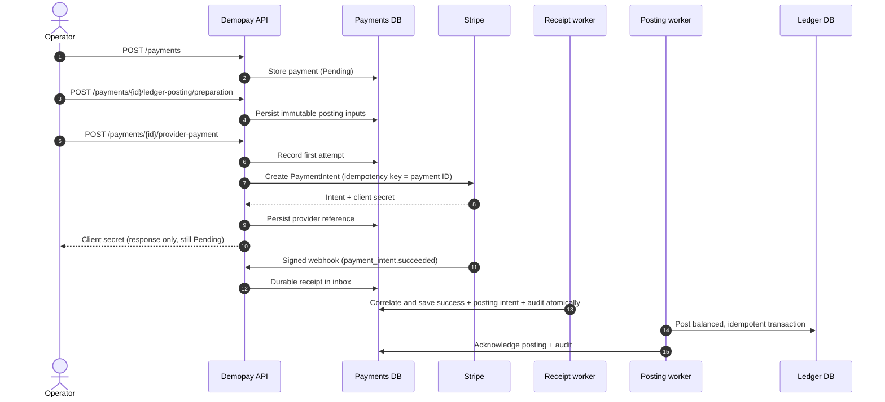
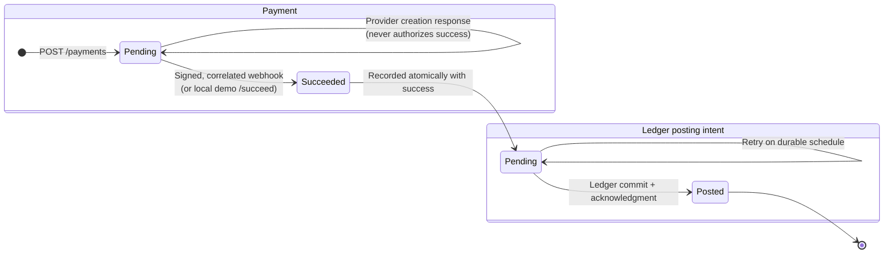
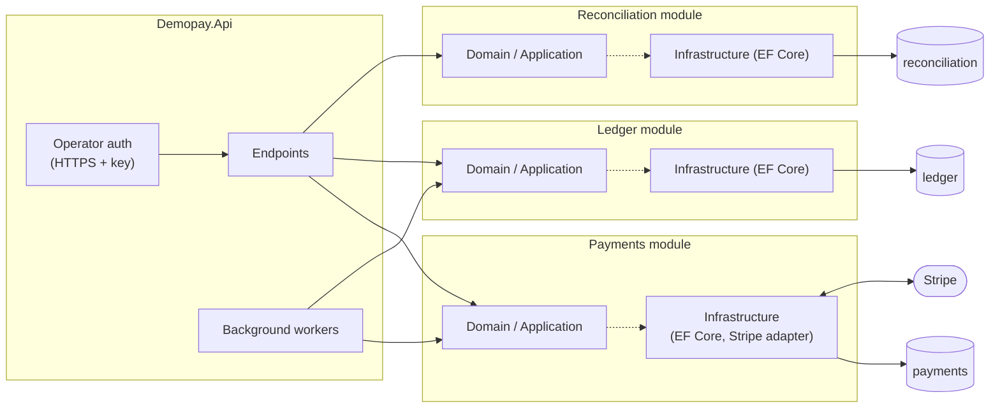

<div align="center">

# 💳 DemoPAY

**A locally runnable .NET modular payment backend — Payments · Ledger · Reconciliation**

[](https://github.com/JClerve/Modular-Payment/actions/workflows/ci.yml)


[Quick start](#-quick-start) •
[How a payment flows](#-how-a-payment-flows) •
[Capabilities](#-backend-capabilities) •
[API](#-api-overview) •
[Docs](#-documentation-map)

</div>

---

Demopay is a portfolio project built as a **modular monolith**. Payments, Ledger and Reconciliation each have their own PostgreSQL persistence context. Stripe PaymentIntents are the first provider, and a payment is marked complete only on **authenticated webhook evidence**, never on a creation response.

> [!NOTE]
> The agreed deliverable is the **local backend**. No frontend, hosting or deployment is required. Automated acceptance uses the real Stripe SDK with an isolated fake HTTP transport and real local PostgreSQL. **No live external Stripe acceptance is claimed.**

## 🚀 Quick start

**Prerequisites**

- [ ] The SDK selected by `global.json` (currently **.NET 10.0.401**)
- [ ] A running Docker daemon, with permission to start PostgreSQL containers
- [ ] Network access for restore and the first image pulls (the payment acceptance itself makes no external provider requests)

```sh
dotnet restore Demopay.slnx
dotnet build Demopay.slnx --configuration Release --no-restore
dotnet test Demopay.slnx --configuration Release --no-build --verbosity minimal
```

<details>
<summary><b>▶ Run only the end-to-end Stripe acceptance test</b></summary>

<br>

```sh
dotnet test tests/Integration/Api --configuration Release --no-build \
  --filter FullyQualifiedName~CreatedProviderPaymentCompletesOnlyFromSignedEvidenceAndPostsBalancedLedgerOnce \
  --verbosity normal
```

This starts three isolated PostgreSQL containers, applies every module migration, creates a PaymentIntent through the real Stripe SDK over fake HTTP, rejects a bad signature, and then drives a valid signed webhook through both workers. The result is one balanced Ledger transaction: **1234 debit / 1200 merchant credit / 34 revenue credit**.

</details>

<details>
<summary><b>▶ Try the interactive operator API (no Stripe credentials)</b></summary>

<br>

The full, copy-pasteable walkthrough is in [docs/LOCAL_DEMO.md](docs/LOCAL_DEMO.md#interactive-operator-api-without-stripe-credentials). In short:

1. Generate a random operator key and Postgres password into your shell.
2. Start a local `postgres:18-alpine` container and create the three module databases.
3. Apply the EF Core migrations for each module.
4. Run the API with the `https` launch profile (`https://localhost:7220`).
5. Provision accounts, create a payment, mark it succeeded locally, and watch the posting worker write a balanced transaction.

</details>

## 🔄 How a payment flows



<details>
<summary><b>🧭 Payment and posting states</b></summary>

<br>



</details>

## 🧱 Architecture at a glance



The Payments Domain/Application projects contain no Stripe SDK types; provider ports use neutral request/result/evidence types. See [ARCHITECTURE.md](docs/ARCHITECTURE.md) for boundaries and recovery guarantees.

## ✨ Backend capabilities

|     | Area                   | What you get                                                                                                                                                                                      |
| :-: | ---------------------- | ------------------------------------------------------------------------------------------------------------------------------------------------------------------------------------------------- |
| 📒  | **Ledger**             | Explicit account provisioning with idempotent replay and rejection of conflicting identity/currency. Balanced, immutable transaction posting with concurrent replay protection.                   |
| 🔁  | **Provider creation**  | Payment-derived provider idempotency, persisted preparation and first-attempt timestamps, conservative creation retry limits, verified original-intent recovery and response-only client secrets. |
| 📨  | **Webhooks & workers** | Durable signed receipt ingestion, authoritative correlated completion, atomic success/posting-intent/audit recording, and separately retrying receipt and Ledger posting workers.                 |
| 🔐  | **Operations**         | Default-on local operator authentication over HTTPS, public dependency-free liveness, all-module database/schema readiness, and tag-free worker metrics.                                          |

<details>
<summary><b>📐 Scope: what is and isn't included</b></summary>

<br>

Accounting inputs are always explicit: transaction, ledger and account IDs, gross amount/currency and the chosen fee. Worker and provider integrations are opt-in.

| ✅ In scope                                     | ❌ Out of scope                      |
| ----------------------------------------------- | ------------------------------------ |
| Local payment lifecycle                         | Merchant routing                     |
| Stripe PaymentIntents (fake transport in tests) | Fee policy                           |
| Double-entry Ledger                             | Multi-tenant customer authentication |
| Caller-supplied reconciliation comparisons      | Refunds and payouts                  |
| Single local operator key                       | Public customer API                  |

> [!WARNING]
> Do not use the local demo key model as a public customer API.

</details>

## 🌐 API overview

> [!IMPORTANT]
> Every route below requires the `X-Demopay-Operator-Key` header over HTTPS unless marked 🌍 public. Set a randomly generated `LocalApiAccess__OperatorKey` of **at least 32 characters** before starting the host. Access is enabled by default.

<details open>
<summary><b>💳 Payments</b></summary>

| Method | Route                                       | Purpose                                                                    |
| :----: | ------------------------------------------- | -------------------------------------------------------------------------- |
| `POST` | `/payments`                                 | Create a pending local payment                                             |
| `GET`  | `/payments/{id}`                            | Inspect local status/reference                                             |
| `POST` | `/payments/{id}/ledger-posting/preparation` | Persist immutable explicit posting inputs                                  |
| `POST` | `/payments/{id}/provider-payment`           | Create the provider intent inside the retry window                         |
| `GET`  | `/payments/{id}/provider-payment`           | Retrieve and correlate the stored provider intent                          |
| `POST` | `/payments/{id}/provider-reference`         | Recover a supplied original intent; verified lookup when Stripe is enabled |
| `GET`  | `/payments/{id}/ledger-posting`             | Inspect posting status/retry/acknowledgment                                |
| `POST` | `/payments/{id}/succeed`                    | Provider-disabled local demonstration path only                            |
| `POST` | `/payments/webhooks/stripe` 🌍              | Public, signature-authenticated durable receipt ingress                    |

</details>

<details>
<summary><b>📒 Ledger</b></summary>

| Method | Route                       | Purpose                                             |
| :----: | --------------------------- | --------------------------------------------------- |
| `POST` | `/ledger/accounts`          | Provision explicit account identity/ledger/currency |
| `POST` | `/ledger/transactions`      | Explicit balanced posting                           |
| `GET`  | `/ledger/transactions/{id}` | Retrieve a transaction                              |

</details>

<details>
<summary><b>🧮 Reconciliation</b></summary>

| Method | Route                   | Purpose                                                   |
| :----: | ----------------------- | --------------------------------------------------------- |
| `POST` | `/reconciliations`      | Store a caller-supplied expected-versus-actual comparison |
| `GET`  | `/reconciliations/{id}` | Inspect a comparison                                      |

</details>

<details>
<summary><b>❤️ Health</b></summary>

| Method | Route              | Purpose                     |
| :----: | ------------------ | --------------------------- |
| `GET`  | `/health/live` 🌍  | Public liveness             |
| `GET`  | `/health/ready` 🌍 | Dependency/schema readiness |

</details>

<details>
<summary><b>🧪 Example: create a payment with curl</b></summary>

<br>

```sh
# Keeps the operator key out of process arguments
api() {
  curl --silent --show-error --fail --config - "$@" <<CURL
header = "X-Demopay-Operator-Key: $LocalApiAccess__OperatorKey"
CURL
}

export Demopay_URL=https://localhost:7220
curl --fail "$Demopay_URL/health/ready"

api -H 'Content-Type: application/json' \
  -d '{"amount":12.34,"currency":"SGD"}' \
  "$Demopay_URL/payments"
```

</details>

## 📚 Documentation map

| Document                                       | Read it when you want to…                                                  |
| ---------------------------------------------- | -------------------------------------------------------------------------- |
| [📘 Local demo runbook](docs/LOCAL_DEMO.md)    | Run the fully local Stripe flow or the interactive operator API            |
| [🛠️ Operations](OPERATIONS.md)                 | Configure the host, apply migrations, read metrics, recover orphans safely |
| [🏛️ Architecture](docs/ARCHITECTURE.md)        | Understand module boundaries and recovery guarantees                       |
| [✅ Acceptance evidence](docs/ACCEPTANCE.md)   | See exact verified commits and known limits                                |
| [📍 Project checkpoint](PROJECT_CHECKPOINT.md) | Pick up continuation history                                               |

<details>
<summary><b>🗂️ Repository layout</b></summary>

<br>

```text
app/
├── Api/                                 # Host, endpoints, auth, health, workers
└── Modules/
    ├── Payments[.Infrastructure]/       # Payments domain + EF Core + Stripe adapter
    ├── Ledger[.Infrastructure]/         # Double-entry ledger + EF Core
    └── Reconciliation[.Infrastructure]/
tests/
├── Unit/                                # Payments, Ledger, Reconciliation
└── Integration/
    ├── Api/                             # End-to-end HTTP + workers + PostgreSQL
    └── *.Infrastructure/                # Per-module PostgreSQL tests
```

</details>

---

<div align="center">
<sub>Built with .NET, PostgreSQL and Stripe as a portfolio project.</sub>
</div>
